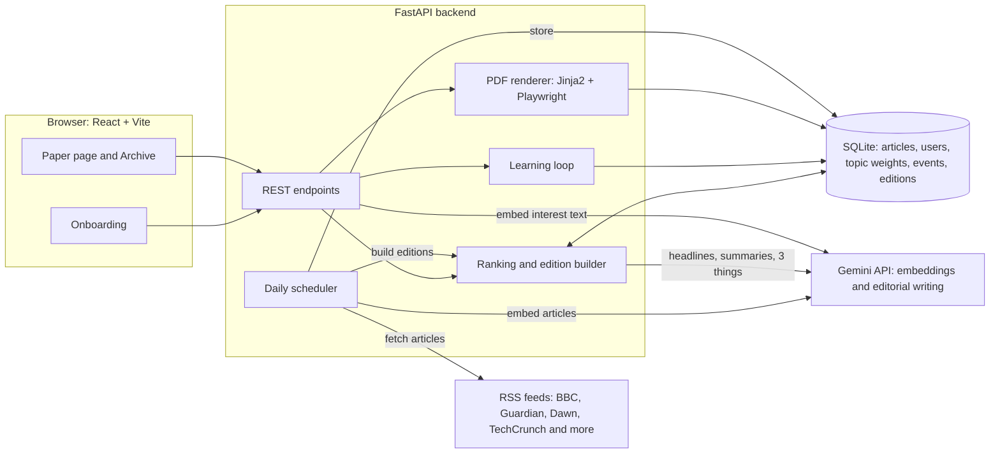
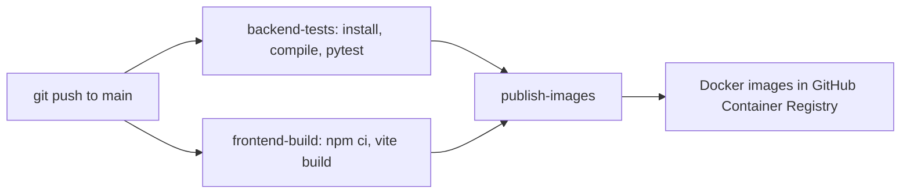

# The Daily You

**A personal morning paper.** News is scattered across dozens of sites. The Daily You learns what each reader cares about, gathers the articles that matter from across the web, and prints one personal newspaper every day: readable on the web, downloadable as a newspaper-style PDF, and smarter the more you use it.

Built solo for the NaSCon 26 AI Hackathon (FAST NUCES).

## Features

- **Onboarding in three quick steps:** name, topic chips, and a free-text "what are you into?" box with suggestion chips.
- **Personalised front page:** the story you are most likely to care about becomes the hero, the next best are secondary stories, and the rest become briefs.
- **"Outside your bubble":** one story from a topic you did not pick, so the paper helps you discover things.
- **AI editor (Gemini):** rewrites headlines, writes short grounded summaries, an editor's note, and a **"3 things you learned today"** box.
- **Web paper:** click through to any original article, hit **Not for me** to skip a story, refresh the paper, browse the **archive** of past editions.
- **Newspaper PDF:** the same edition as a print-style PDF (masthead, columns, clickable headlines). Skipped stories are removed from it too.
- **It learns:** every click and skip reshapes your interest profile, so tomorrow's paper reflects what you actually read.
- **Fresh every day:** a built-in scheduler re-fetches the news, embeds it, and builds editions without anyone pressing a button.
- **Junk filter:** quizzes, newsletters, and roundup items are kept out of the news slots.
- **CI/CD:** GitHub Actions runs tests, builds the frontend, and publishes Docker images.

## How it works



### The edition pipeline

1. **Ingest:** RSS feeds across 10 topics are fetched, cleaned, de-duplicated by URL, and stored.
2. **Embed:** each article (title + summary) is turned into a 768-dimension vector with `gemini-embedding-001`.
3. **Rank:** for every reader, each article gets a score:
   `score = cosine(reader vector, article vector) + 0.15 × topic weight + 0.10 × freshness`
   Articles the reader already clicked, skipped, or saw in their last editions are excluded, and no topic may take more than 4 slots.
4. **Assemble:** top story → hero, next four → secondary, the rest → briefs, plus one "outside your bubble" pick.
5. **Edit:** one Gemini call rewrites headlines and blurbs (using only facts from the source text), and writes the editor's note and "3 things you learned today".
6. **Publish:** the edition is stored as JSON (one per reader per day), served to the web page, and rendered to PDF on demand.

### How it learns

| Reader action | Interest vector | Topic weight |
|---|---|---|
| Clicks a story | moves **toward** that article | +0.10 (a new topic is added at 0.1) |
| Skips a story ("Not for me") | moves **away** from that article | −0.10 |

The profile is recalculated instantly, so pressing **Refresh paper** after a few skips visibly changes the next edition.

## Tech stack

| Layer | Tech |
|---|---|
| Frontend | React, Vite, react-router-dom, custom newspaper CSS |
| Backend | Python, FastAPI, SQLite, feedparser, httpx, numpy |
| AI | Google Gemini (`gemini-3.8-flash` for writing, `gemini-embedding-001` for embeddings) |
| PDF | Jinja2 template rendered to PDF by headless Chromium (Playwright) |
| CI/CD | GitHub Actions, Docker, GitHub Container Registry |

## Run it locally

You need Python 3.12+, Node 22+, and a free Gemini API key from [Google AI Studio](https://aistudio.google.com).

### 1. Backend

```bash
cd backend
python -m venv .venv
# Windows:      .venv\Scripts\activate
# Mac / Linux:  source .venv/bin/activate
pip install -r requirements.txt
playwright install chromium
```

Create `backend/.env` containing one line:

```
GEMINI_API_KEY=your_key_here
```

Start the server:

```bash
uvicorn app.main:app --reload
```

On first start the daily scheduler fetches and embeds the news automatically (about 3 to 4 minutes on the free Gemini tier, which allows 100 embedding requests per minute). You can also run it by hand:

```bash
python -m app.daily
```

API docs are at http://127.0.0.1:8000/docs.

### 2. Frontend

```bash
cd frontend
npm install
npm run dev
```

Open http://localhost:5173, complete onboarding, and your first edition is printed.

### 3. Tests

```bash
cd backend
python -m pytest -q
```

## CI/CD



The pipeline lives in `.github/workflows/ci-cd.yml`. Images are published for both the backend and the frontend (nginx).

## Project structure

```
backend/
  app/
    main.py            API endpoints
    db.py              SQLite schema and connection
    feeds.py           RSS sources per topic
    ingest.py          fetch and store articles
    embed_articles.py  embed new articles
    ai.py              Gemini client and embedding helper
    edition.py         ranking, selection, editorial layer
    learning.py        click / skip profile updates
    filters.py         keeps quizzes and newsletters out of the news
    pdf.py, render_pdf.py, templates/paper.html   PDF generation
    daily.py           scheduled ingest, embed, build
  tests/
frontend/
  src/pages/           Onboarding, Paper, Archive
.github/workflows/     CI/CD pipeline
```

## Honest limitations

- RSS feeds give headlines and summaries, not full article text, so the AI works from short summaries.
- SQLite and a single process are fine for a prototype, not for thousands of readers.
- The free Gemini tier is rate-limited, so editions are cached per reader per day and rebuilt on request.
- There is no login: a reader is identified by a profile stored in the browser.
- The junk filter is keyword based.

## Ideas for next

A "Go deeper" button that explains any story at beginner level, a daily mini-quiz on your own paper, an audio edition, and real accounts.
